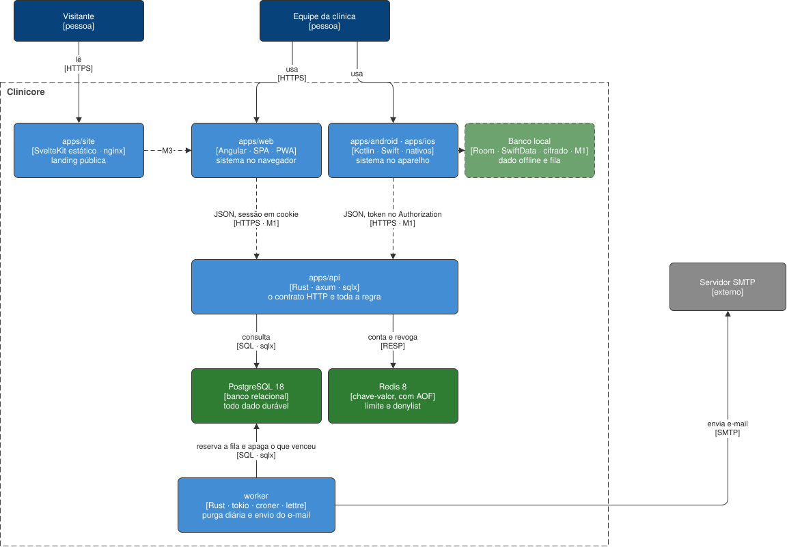

# Blocos de construção

O sistema decomposto em processos e armazenamentos. Cada bloco tem o próprio arquivo, com o que ele
faz, o que ele nunca faz e o que é preciso saber para mudá-lo.

| Bloco | Tecnologia | Responsabilidade | Fala com | Marco | Arquivo |
| --- | --- | --- | --- | --- | --- |
| `apps/api` | Rust · axum · sqlx | o contrato HTTP e toda a regra de negócio | PostgreSQL (SQL) e Redis (RESP) | existe: cadastro, confirmação de e-mail e sessão; os módulos de produto no M1 | [api.md](api.md) |
| `apps/web` | Angular · SPA estático com PWA | o sistema da clínica no navegador | `apps/api` (HTTPS, JSON, sessão em cookie) | existe como scaffold em React; Angular e telas no M1 | [web.md](web.md) |
| `apps/android` | Kotlin · Jetpack Compose | o sistema da clínica no Android, com offline | `apps/api` (HTTPS, JSON, token no `Authorization`) | M1 | [android.md](android.md) |
| `apps/ios` | Swift · SwiftUI | o sistema da clínica no iOS, com offline | `apps/api` (HTTPS, JSON, token no `Authorization`) | M1 | [ios.md](ios.md) |
| `apps/site` | SvelteKit estático | a landing pública e indexável | ninguém hoje; o `apps/web` por link no M3 | existe como scaffold em Next; SvelteKit e conteúdo no M3 | [site.md](site.md) |
| PostgreSQL 18 | banco relacional | todo dado durável | — | existe | [postgres.md](postgres.md) |
| Redis 8 | chave-valor com AOF | contagem do limite de requisições e denylist de sessão | — | existe | [redis.md](redis.md) |
| worker | Rust · tokio · croner · lettre, em `apps/api/crates/worker/` | a purga diária do que venceu e o envio do e-mail da fila `email_outbox`, com retry | PostgreSQL (SQL) e SMTP | existe | [worker.md](worker.md) |
| Banco local dos apps | Room com SQLCipher no Android; SwiftData sob Data Protection no iOS | o dado offline e a fila de escrita | — | M1 · [ADR 0022](../../decisions/0022-apps-nativos-em-kotlin-e-swift.md) | descrito em [android.md](android.md) e [ios.md](ios.md) |
