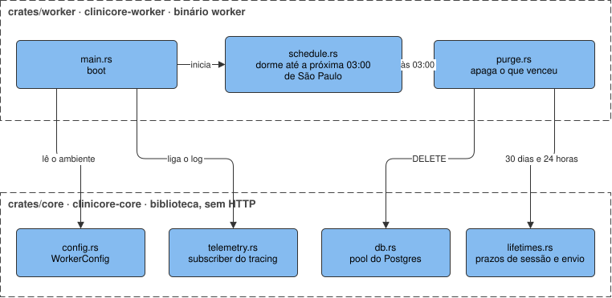

# worker

O processo da API que trabalha fora da requisição, em Rust, no `apps/api/crates/worker/`. Ele envia o
e-mail que a API grava na fila `email_outbox` e purga o que venceu, uma vez por dia
([spec 006](../../specs/autenticacao/006-worker-e-fila-de-email-api.md),
[ADR 0017](../../decisions/0017-fila-de-email-no-postgres-e-worker-com-cron.md)).

**Nunca faz:** responder HTTP, depender do `clinicore-app`, guardar estado em memória que outra
instância precise ver, purgar no boot, conectar no SMTP antes do primeiro envio.

## Blocos internos

| Bloco | Onde | Responsabilidade |
| --- | --- | --- |
| Boot | `crates/worker/src/main.rs` | lê o `WorkerConfig`, liga o `tracing`, abre o pool, monta o `Mailer` e roda a fila e o agendamento até o sinal de parada |
| Fila | `crates/worker/src/outbox.rs` | a cada 5 segundos reserva até 10 e-mails, envia um por vez, apaga o enviado e adia ou desiste do que falhou |
| E-mail | `crates/worker/src/mail.rs` | o `Mailer`: o SMTP do `lettre` com pool, STARTTLS e 10 segundos de timeout por envio |
| Agendamento | `crates/worker/src/schedule.rs` | calcula a próxima `0 3 * * *` em `America/Sao_Paulo` com o `croner` sobre o `jiff`, dorme até ela, purga e repete |
| Purga | `crates/worker/src/purge.rs` | apaga a sessão vencida ou que passou dos 30 dias, a verificação vencida, o registro de envio com mais de 24 horas e o e-mail vencido da fila, e registra as quantidades no log |
| `core` | `crates/core/` | configuração, pool do Postgres, sinal de parada, subscriber do `tracing` e os prazos `SESSION_ABSOLUTE_LIFETIME` e `DISPATCH_WINDOW`, compartilhados com a API |

## O que ele garante

- **Cada e-mail é reservado por um worker só.** A reserva soma 1 a `attempts`, empurra `next_attempt_at`
  2 minutos e é comitada antes do envio, com `FOR UPDATE SKIP LOCKED`. Um worker que cai no meio do envio
  devolve a linha à fila quando os 2 minutos passam.
- **A entrega é pelo menos uma vez.** Um worker que cai depois de o SMTP aceitar e antes de apagar a
  linha manda o mesmo e-mail de novo.
- **A falha volta com backoff**: 1, 2, 4 e 8 minutos, com `warn` `mail delivery failed, retrying`. A
  quinta falha marca a linha `failed`, apaga os dois corpos na mesma escrita e registra `error`
  `mail delivery gave up`. O endereço sai mascarado no log, como `a***@exemplo.com`.
- **E-mail vencido não sai.** A linha cujo `expires_at` passou espera a purga, porque o link dela já
  não abre nada.
- **A parada termina o que está em andamento.** Com `SIGTERM` ou `Ctrl+C`, o worker para de reservar,
  termina o envio em curso, grava o resultado e sai com código 0; a purga em curso também termina.
- **A primeira purga é a próxima 03:00.** Se o worker estiver parado às 03:00, a purga daquele dia não
  acontece; ela só volta na 03:00 seguinte.
- **Duas instâncias purgam duas vezes, e a segunda apaga zero linhas.** Não há lock: o `DELETE` é
  idempotente.
- **Uma purga que falha é registrada em `error`** e espera a 03:00 seguinte.
- **O ambiente incompleto impede o boot:** o worker escreve `Invalid environment:` e uma linha por
  variável recusada, e sai com código 1 antes de abrir conexão.

## Para mudar com segurança

Rodar: `infisical run --path=/api -- cargo run -p clinicore-worker`. Em dev ele envia e-mail de verdade,
então o teste à mão usa só endereço `@example.com`. Os testes ficam em `crates/worker/tests/worker/`,
com as mesmas regras de teste da API, descritas no
[`apps/api/AGENTS.md`](https://github.com/TheoOdawara/clinicore/blob/staging/apps/api/AGENTS.md). O
horário, o fuso e a tabela de backoff são o comportamento: mudar qualquer um muda o que a spec 006
decidiu.
