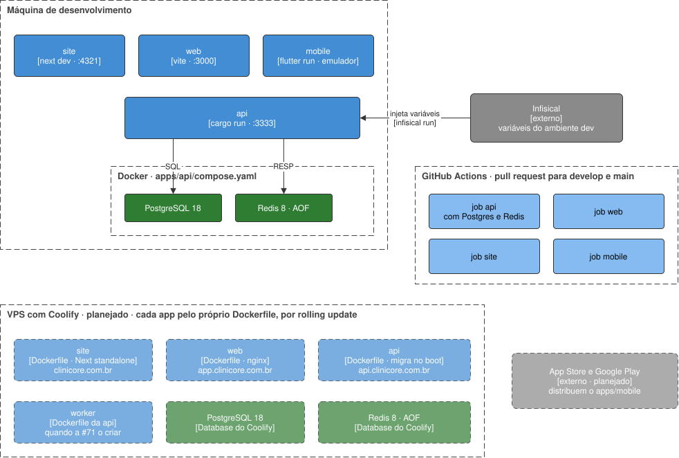

# Implantação

Onde cada bloco roda, em cada ambiente, e como ele chega lá.

## Ambientes

| Ambiente | Estado | Onde roda |
| --- | --- | --- |
| Desenvolvimento | existe | a máquina de quem desenvolve |
| CI | existe | GitHub Actions |
| Homolog (`staging`) | planejado | a VPS com Coolify |
| Produção (`main`) | planejado | a VPS com Coolify |

**Não há hospedagem hoje.** Nenhum app tem Dockerfile ainda. Cada um vai ser publicado no Coolify pelo
próprio `apps/<app>/Dockerfile`, por rolling update, como decide a
[ADR 0014](../decisions/0014-deploy-por-dockerfile-no-coolify.md).

## Desenvolvimento

| Bloco | Como roda | Porta |
| --- | --- | --- |
| `apps/api` | `cargo run`, dentro do `infisical run --path=/api --` | 3333 |
| `apps/web` | `npm run dev` | 3000 |
| `apps/site` | `npm run dev` | 4321 |
| `apps/mobile` | `flutter run --dart-define-from-file=config/<ambiente>.json`, no emulador ou no aparelho | — |
| PostgreSQL 18 e Redis 8 | `docker compose up`, pelo `apps/api/compose.yaml` | as do Infisical |

As variáveis da API vêm do Infisical, no ambiente `dev`; nenhum arquivo `.env` com valor real fica no
disco. No emulador Android, a API local é `http://10.0.2.2:3333`.

## Produção e homolog — planejado

| Bloco | Endereço | Como roda |
| --- | --- | --- |
| `apps/site` | `clinicore.com.br` | aplicação do Coolify pelo `apps/site/Dockerfile`, com o servidor standalone do Next.js |
| `apps/web` | `app.clinicore.com.br` | aplicação do Coolify pelo `apps/web/Dockerfile`, com o nginx servindo o build do Vite |
| `apps/api` | `api.clinicore.com.br` | aplicação do Coolify pelo `apps/api/Dockerfile`, com o binário `api`, que migra o schema no boot |
| worker | — | aplicação do Coolify com o Dockerfile da API e o binário `worker`; a aplicação nasce com a #4, e até lá nada purga nem envia e-mail fora do desenvolvimento |
| PostgreSQL 18 | rede interna | recurso Database do Coolify, com volume cifrado ([NFR-SEC-05](../requirements/non-functional/security.md#nfr-sec-05--criptografia-em-repouso)) |
| Redis 8 | rede interna | recurso Database do Coolify, com `--appendonly yes` e volume |
| `apps/mobile` | App Store e Google Play | publicado pelas lojas |

Os três domínios compartilham o domínio registrável, o que mantém o cookie de sessão em
`SameSite=Lax`. Atrás do proxy, a API lê o IP do cliente do header que só o proxy escreve, definido em
`CLIENT_IP_SOURCE`, e só pode ser alcançável por ele. Nenhuma aplicação publica porta no host.

Backup e recuperação estão em aberto, na
[OQ-11](../requirements/open-questions.md#oq-11--backup-e-recuperação).

## Entrega

- **Toda entrega chega por pull request** para a `staging`; o release é um pull request da `staging`
  para a `main`.
- **O CI roda em todo pull request** para as duas, por `.github/workflows/ci.yml`, com um job por app:
  `api` (com PostgreSQL e Redis de serviço), `web`, `site` e `mobile`. Os gates de cada job são os do
  [`AGENTS.md`](https://github.com/TheoOdawara/clinicore/blob/staging/AGENTS.md), em Comandos.
- **Não há deploy automático.** Ele nasce junto da hospedagem.
- **Toda publicação é um rolling update.** O container novo sobe ao lado do antigo e só recebe tráfego
  depois de passar no health check do `/health`; o antigo para em seguida. Por isso toda migration é
  compatível com a versão anterior da API
  ([NFR-REL-04](../requirements/non-functional/reliability.md#nfr-rel-04--publicação-sem-indisponibilidade)).
- **O build do app nativo está fora do CI** até a publicação nas lojas.
