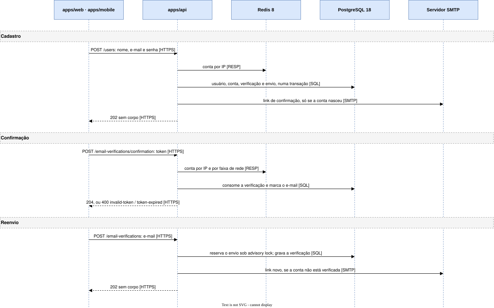

# Cadastro e confirmação de e-mail

Uma pessoa cria a conta e confirma o endereço. Cobre `FR-ACC-07` e `FR-ACC-15`. A resposta nunca revela se o e-mail
já tinha conta.

## Cadastro

1. **O cliente** (web ou app) manda `POST /users` para a **API**, com nome, e-mail e senha.
2. **A API** passa a requisição pelos guards, nesta ordem: cliente, origem, limite por IP no **Redis** e
   validação do corpo.
3. **A API** gera o hash Argon2 da senha e um segredo aleatório para o link.
4. **A API** grava no **PostgreSQL**, numa transação, o usuário, a conta de credencial, o registro do
   envio, a verificação com o hash do segredo e, na fila `email_outbox`, o e-mail com o link
   `<APP_ORIGIN>/verify-email?token=<segredo>`. Um e-mail que já existe não cria nada, por
   `ON CONFLICT … DO NOTHING`.
5. **A API** responde `202`, sem corpo, nos dois casos.

## Confirmação

1. **A pessoa** abre o link, e **o cliente** manda `POST /email-verifications/confirmation` para a
   **API**, com o token no corpo.
2. **A API** conta a requisição por IP e pela faixa de rede no **Redis**, porque o corpo só traz o token.
3. **A API** consome a verificação no **PostgreSQL** pelo hash do token e marca o e-mail como
   verificado.
4. **A API** responde `204`. Token desconhecido responde `400 invalid-token`, e token vencido,
   `400 token-expired`.

## Reenvio

1. **O cliente** manda `POST /email-verifications` para a **API**, com o e-mail.
2. **A API** reserva um envio para o endereço no **PostgreSQL**, serializado por
   `pg_advisory_xact_lock`. Sem envio disponível na janela de 24 horas, nada sai.
3. **A API**, na mesma transação e só se o endereço é de uma conta ainda não verificada, grava uma
   verificação nova e o e-mail na fila.
4. **A API** responde `202`, sem corpo, em todos os casos.

Um login com senha correta numa conta não verificada dispara o mesmo reenvio e responde
`403 email-not-verified`.

## Envio

1. **O [worker](../building-blocks/worker.md)**, a cada 5 segundos, reserva no **PostgreSQL** até 10
   e-mails da fila que ainda não venceram, com `FOR UPDATE SKIP LOCKED`, e comita a reserva antes de
   enviar.
2. **O worker** entrega cada e-mail ao **servidor SMTP**, um por vez.
3. **O worker** apaga o e-mail entregue. O que falhou volta à fila 1, 2, 4 e 8 minutos depois, e a
   quinta falha o marca `failed` e apaga o corpo.

O SMTP fora do ar não muda a resposta da API, que já respondeu `202`.
