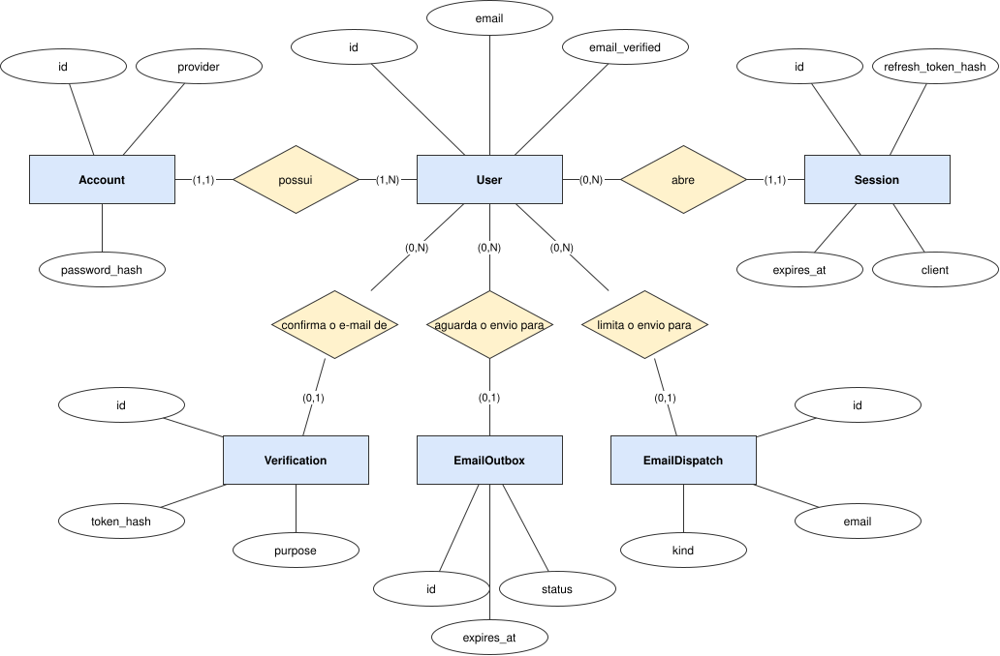
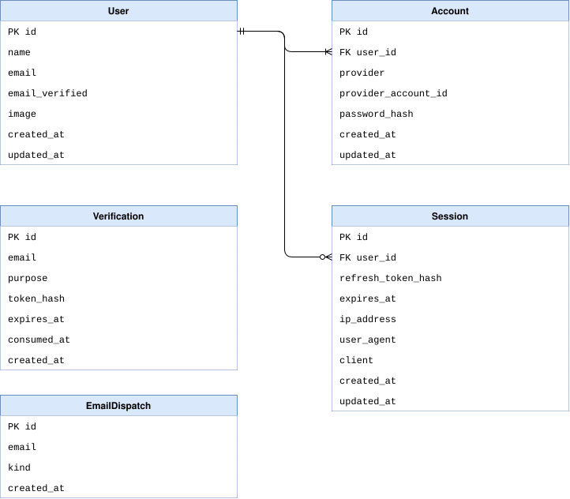
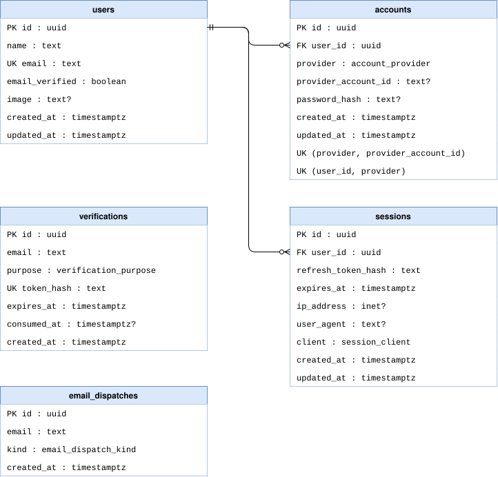

# Modelo de dados

O que o sistema guarda hoje: a conta, a sessão e a confirmação de e-mail. As entidades dos módulos de
produto — cliente, clínica, paciente, agenda, prontuário, financeiro, estoque, laboratório — entram
aqui com a spec de cada um, no M1.

## Modelo conceitual

`Verification` e `EmailDispatch` se ligam ao `User` pelo endereço de e-mail, não por chave estrangeira:
as duas existem para um endereço, e sobrevivem ao usuário até vencerem.

## Modelo lógico

## Modelo físico

Lido do catálogo de um PostgreSQL 18 com a única migration de `apps/api/migrations/`,
`20260929120000_init.sql`, aplicada em 2026-10-15. Hoje há um módulo só, o de acesso, então os
diagramas inteiros são também os do módulo.

## Entidades

| Entidade | O que é | Marco |
| --- | --- | --- |
| User | uma pessoa que entra no sistema | existe |
| Account | um jeito de essa pessoa provar quem é: senha ou Google | existe |
| Session | um login ativo num navegador ou num aparelho | existe |
| Verification | um token de uso único mandado a um e-mail: confirmação de e-mail ou redefinição de senha | existe |
| EmailDispatch | o registro de um e-mail enviado, para limitar o envio | existe |
| EmailOutbox | um e-mail transacional esperando o envio pelo worker | M1 · #71 |

## Invariantes

- **User:** o e-mail é único e está sempre em minúsculas, mas pode mudar; a chave é o `id`. Só um
  usuário com e-mail verificado abre sessão.
- **Apagar um usuário** apaga as contas e as sessões dele em cascata, e por isso as sessões são revogadas
  na denylist do Redis antes do `DELETE`.
- **Account:** um usuário tem no máximo uma conta por provedor, uma conta de provedor externo pertence a
  um usuário só, e toda conta de credencial tem o hash Argon2 da senha.
- **Session:**
  - um usuário tem no máximo 5 sessões, e abrir a sexta apaga a mais antiga;
  - nenhuma sessão vive mais de 30 dias, contados do `created_at`;
  - o `expires_at` é renovado a cada rotação: 24 horas no web, 7 dias no app;
  - o refresh token nunca é guardado, só o hash, que troca a cada rotação, e o `user_agent` é cortado em
    512 caracteres;
  - toda sessão apagada antes de vencer é escrita antes na denylist do Redis
    ([ADR 0012](../decisions/0012-revogacao-de-sessao-antes-de-apagar.md)).
- **Verification:**
  - o segredo do link nunca é guardado, só o hash, e a busca é sempre por ele;
  - toda verificação vence 1 hora depois da emissão;
  - token vencido ou já consumido não confirma nada, e confirmar um token consome todas as verificações
    pendentes do mesmo endereço e do mesmo `purpose`;
  - apagar o usuário não apaga a verificação, que some pela purga quando vence.
- **EmailDispatch:** um endereço recebe no máximo 5 e-mails do mesmo tipo em 24 horas, e no máximo 1 a
  cada 60 segundos, exista ou não uma conta nele. A contagem e o registro acontecem sob o mesmo lock por
  endereço, então dois pedidos simultâneos não passam os dois.
- **EmailOutbox** (M1 · #71, [spec 006](../specs/autenticacao/006-worker-e-fila-de-email-api.md)):
  - nasce na mesma transação da verificação que o link carrega, com o mesmo `expires_at`;
  - a linha enviada é apagada, e a que vence nunca é enviada;
  - só a linha `pending` guarda os corpos; a quinta falha a marca `failed` e apaga os dois na mesma
    escrita;
  - dois workers nunca reservam a mesma linha, e a reserva que ninguém fechou volta em 2 minutos.

## Conteúdo

- [Padrões de acesso](access-patterns.md) — cada operação, o que ela lê e escreve
- [Armazenamento](storage.md) — tipos, índices, migrations e o que fica fora do PostgreSQL
