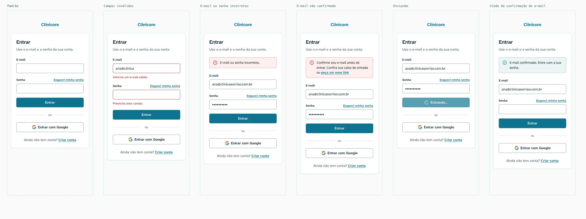
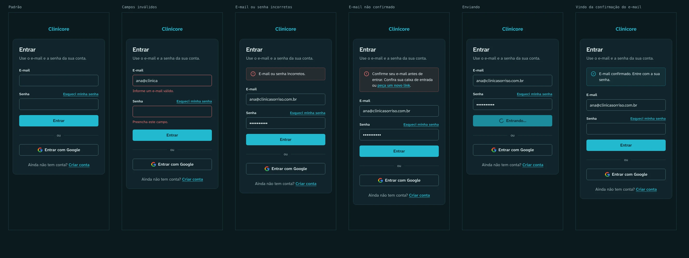
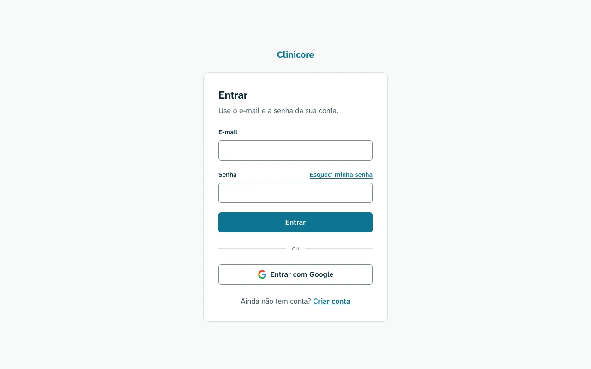

# Entrar — `/login`

Protótipo: [`login.html`](login.html). A regra de cada estado está na
[spec do web](../../../specs/autenticacao/003-autenticacao-web.md).

## 390px

## Desktop

## Áreas

1. O nome, como texto na cor primária, até a marca existir.
2. O cabeçalho do cartão: o título `Entrar` e uma linha de apoio.
3. A região de aviso, com `aria-live="polite"`. Ela só aparece com erro da API ou com o retorno da
   confirmação do e-mail.
4. Os campos E-mail e Senha. O link `Esqueci minha senha` fica na linha do rótulo da senha.
5. O botão `Entrar`, o separador `ou` e o botão `Entrar com Google`.
6. O link para `Criar conta`.

## Estados

| Estado | O que muda |
| --- | --- |
| Padrão | — |
| Campos inválidos | contorno e mensagem de erro sob cada campo, com `role="alert"` |
| E-mail ou senha incorretos | aviso de erro acima do formulário |
| E-mail não confirmado | aviso de erro, com o link para pedir um novo |
| Enviando | botão desabilitado, com o spinner e `Entrando…`, sem mudar de tamanho |
| Vindo da confirmação do e-mail | aviso de sucesso, com o e-mail já preenchido |

## Tokens

`--background`, `--card`, `--border`, `--input`, `--primary`, `--primary-foreground`,
`--muted-foreground`, `--destructive`, `--ring` e `--radius`, todos em [tokens](../../tokens.md).
