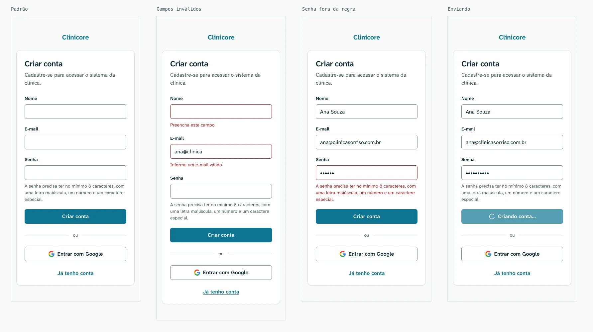
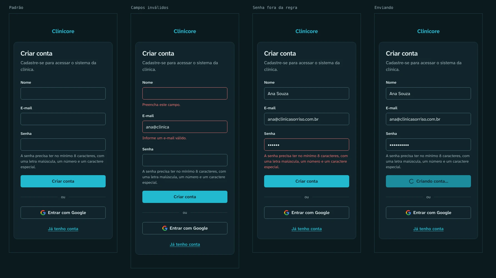
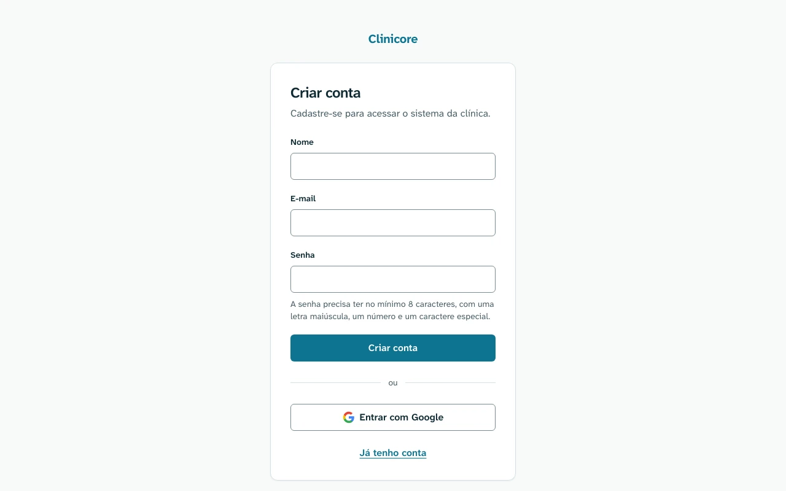

# Criar conta — `/signup`

Protótipo: [`signup.html`](signup.html). A regra de cada estado está na
[spec do web](../../../specs/autenticacao/003-autenticacao-web.md).

## 390px

## Desktop

## Áreas

1. O nome, como texto na cor primária.
2. O cabeçalho do cartão: o título `Criar conta` e uma linha de apoio.
3. Os campos Nome, E-mail e Senha. A regra de senha fica sempre visível sob o campo, ligada a ele por
   `aria-describedby`.
4. O botão `Criar conta`, o separador `ou` e o botão `Entrar com Google`.
5. O link `Já tenho conta`.

## Estados

| Estado | O que muda |
| --- | --- |
| Padrão | — |
| Campos inválidos | contorno e mensagem de erro sob cada campo |
| Senha fora da regra | o texto da regra fica vermelho e passa a ser o erro do campo, com `role="alert"`; nenhuma linha nova aparece |
| Enviando | botão desabilitado, com o spinner e `Criando conta…` |

A tela não tem estado de e-mail já cadastrado: a API responde igual nos dois casos, e o cadastro sempre
leva para [`/verify-email`](verify-email.md).

## Tokens

Os mesmos de [`/login`](login.md).
