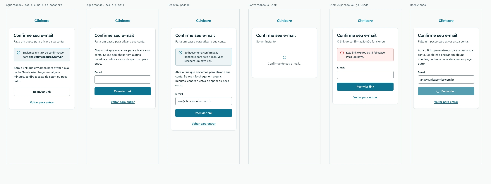
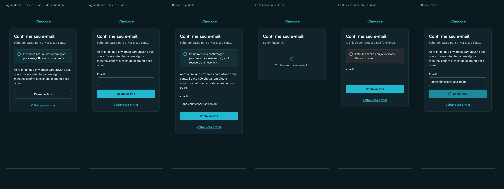
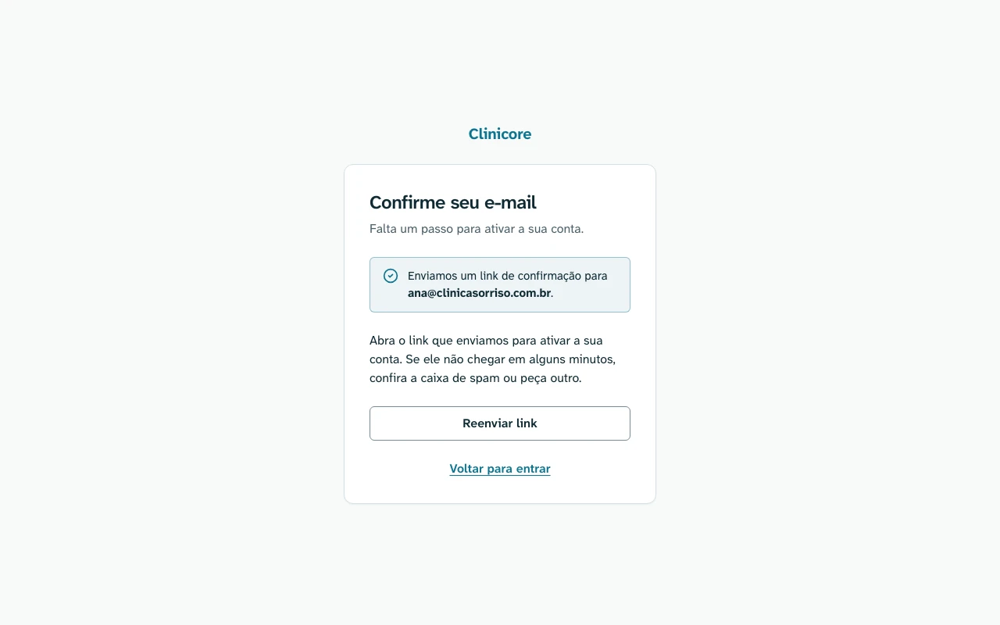

# Confirme seu e-mail — `/verify-email`

Protótipo: [`verify-email.html`](verify-email.html). A regra de cada estado está na
[spec do web](../../../specs/autenticacao/003-autenticacao-web.md).

## 390px

## Desktop

## Áreas

1. O nome, como texto na cor primária.
2. O cabeçalho do cartão: o título `Confirme seu e-mail` e uma linha que muda com o estado.
3. A região de aviso, com `aria-live="polite"`.
4. A instrução, e o campo E-mail quando a tela não sabe para onde o link foi.
5. O botão `Reenviar link`. Ele é contornado quando a ação principal é abrir o e-mail, e preenchido
   quando reenviar é o único caminho.
6. O link `Voltar para entrar`.

## Estados

| Estado | Quando | O que mostra |
| --- | --- | --- |
| Aguardando, com o e-mail do cadastro | sem `token`, com o e-mail no estado da navegação | aviso de sucesso com o e-mail, a instrução e `Reenviar link` contornado |
| Aguardando, sem o e-mail | sem `token` e sem e-mail | a instrução, o campo E-mail e `Reenviar link` |
| Reenvio pedido | depois do `Reenviar link` | o aviso neutro da spec, que não afirma que o e-mail saiu |
| Confirmando o link | com `token`, durante a chamada | o spinner e `Confirmando seu e-mail…`, sem formulário |
| Link expirado ou já usado | `400` com `invalid-token` ou `token-expired` | aviso de erro, o campo E-mail e `Reenviar link` |
| Reenviando | durante o reenvio | botão desabilitado, com o spinner e `Enviando…` |

O `204` da confirmação não tem estado aqui: ele leva para [`/login`](login.md), que mostra
`E-mail confirmado. Entre com a sua senha.`

## Tokens

Os mesmos de [`/login`](login.md).
