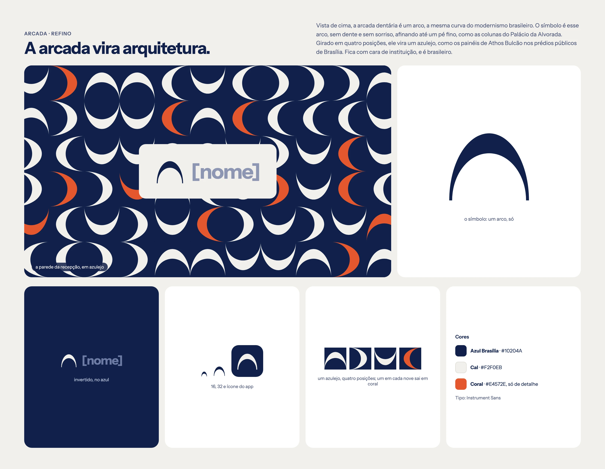

# Marca

A marca aprovada em 2026-10-27 é a rota Arcada. O nome do produto ainda está em aberto
([`OQ-01`](../../requirements/open-questions.md#oq-01--nome-comercial)), então o logotipo usa
"[nome]" no lugar dele, e a marca não depende do nome.

## A ideia

Vista de cima, a arcada dentária é um arco, a mesma curva do modernismo brasileiro: as colunas do
Palácio da Alvorada, de Niemeyer. O símbolo é esse arco, sem dente e sem sorriso. Girado em quatro
posições, ele vira um azulejo, como os painéis de Athos Bulcão nos prédios públicos de Brasília.

## Símbolo

| Uso | Desenho (`viewBox="0 0 48 48"`) |
| --- | --- |
| Padrão | `M2 44A22 37 0 0 1 46 44H44.4A20.4 26 0 0 0 3.6 44Z`: meia elipse externa de 44 × 37 e interna de 40,8 × 26, na mesma base; coroa de 11 e pé de 1,6 |
| Até 24 px | `M2 44A22 38 0 0 1 46 44H43A19 22 0 0 0 5 44Z` |
| Ícone do app | `rect` com `rx="11"` em `#10204A` e o arco `M9 37A15 24 0 0 1 39 37H37.6A13.6 16 0 0 0 10.4 37Z` em cal |

- **Área de respiro:** a altura da coroa, 11 unidades.
- **Tamanho mínimo:** 16 px na tela e 6 mm no impresso.
- **Nunca:** gradiente, achatamento, dente, sombra ou contorno.

## Azulejo

Um ladrilho de 20 unidades, pontudo de propósito: `M0 20A10 16 0 0 1 20 20A10 10.5 0 0 0 0 20Z`. Ele
gira em 0°, 90°, 180° e 270°, e cerca de um em cada nove sai em coral.

## Cores

| Cor | Base | Escala 50 a 950 |
| --- | --- | --- |
| Azul Brasília | 900 · `#10204A` | `#F6F9FF` `#E9F0FF` `#D1E0FF` `#B6CBF6` `#97AEDF` `#768EC4` `#5A73AB` `#445B93` `#2F457B` `#10204A` `#091947` |
| Cal | 100 · `#F2F0EB` | `#FBF9F4` `#F2F0EB` `#E1DFDA` `#CCCAC6` `#AFAEA9` `#918F8B` `#767470` `#5F5D5A` `#494844` `#32302D` `#1F1E1B` |
| Coral | 500 · `#E4572E` | `#FFF7F5` `#FFEBE6` `#FFD5C9` `#FFB6A2` `#FF8765` `#E4572E` `#C73E11` `#A52D00` `#812100` `#5A1400` `#3C0A00` |

O coral é só de forma, nunca de texto.

| Papel | Cor | Contraste |
| --- | --- | --- |
| Texto secundário | `#4A5577` | 6,4:1 sobre cal |
| Link | azul 700 | — |
| Borda de campo | cal 500 | 3:1 |
| Erro | coral 700 · `#A52D00` | 7:1 |

## Tipografia

Instrument Sans.

| Estilo | Tamanho e entrelinha | Peso | Espaçamento |
| --- | --- | --- | --- |
| Display | 48/52 | 700 | −3% |
| Título | 28/34 | 700 | −2% |
| Subtítulo | 18/26 | 600 | — |
| Corpo | 16/24 | 400 | — |
| Legenda | 13/18 | 500 | — |

## Estudos

| Board | O que mostra |
| --- | --- |
| [Arcada](arcada.dc.html) | a rota aprovada: símbolo, azulejo, cores e tipo |
| [Sistema](sistema.dc.html) | as três cores e as escalas delas |
| [Construção](construcao.dc.html) | a geometria do símbolo: duas elipses na mesma base |

Cada board tem a imagem ao lado, em `.webp`.
