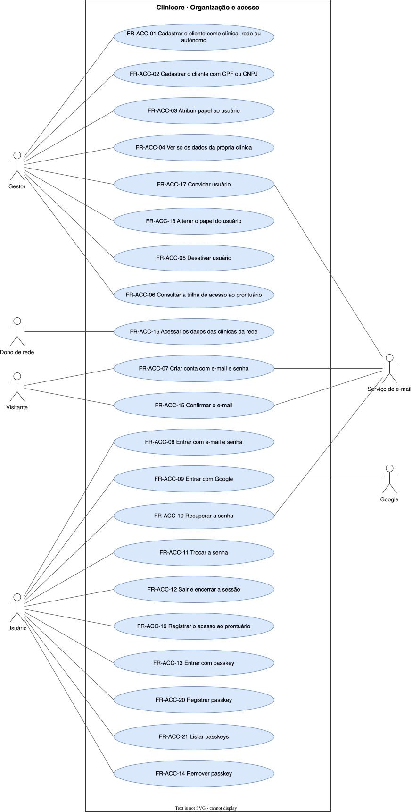

# Organização e acesso — `ACC`

Quem é o cliente, quem entra no sistema, o que cada papel alcança e o que fica registrado do acesso.

## FR-ACC-01 — Cliente como clínica, rede ou dentista autônomo

> Como gestor, quero cadastrar meu negócio como clínica única, rede de clínicas ou dentista autônomo, para que o sistema reflita como eu opero.

O sistema deve permitir que um cliente seja uma clínica única, uma rede de clínicas ou um dentista autônomo sem clínica.

| Atributo | Valor |
| --- | --- |
| Justificativa | Rede e dentista autônomo são clientes do produto, ao lado da clínica única. |
| Origem | Theo, kickoff de 2026-09-15 |
| Prioridade | Must |
| Status | approved |
| Marco | M1 |
| Desde | v1.0.0 |

**Critérios de aceite**

- **FR-ACC-01.1** — Dado um dentista sem clínica, quando ele se cadastra como dentista autônomo, então opera agenda, prontuário e financeiro como cliente próprio.
- **FR-ACC-01.2** — Dada uma rede com 3 clínicas, quando o dono de rede a cadastra, então cada clínica existe como unidade separada dentro do mesmo cliente.

## FR-ACC-02 — Cliente pessoa física ou jurídica

> Como gestor, quero cadastrar o cliente com CPF ou com CNPJ, para que o dentista autônomo sem empresa também seja cliente.

O sistema deve aceitar como cliente tanto uma pessoa física quanto uma pessoa jurídica.

| Atributo | Valor |
| --- | --- |
| Justificativa | O dentista autônomo sem empresa também é cliente. |
| Origem | Theo, kickoff de 2026-09-15 |
| Prioridade | Must |
| Status | approved |
| Marco | M1 |
| Desde | v1.0.0 |

**Critérios de aceite**

- **FR-ACC-02.1** — Dado um cadastro de cliente, quando é informado um CPF válido no lugar do CNPJ, então o cliente é criado como pessoa física.

## FR-ACC-03 — Papéis com permissões distintas

> Como gestor, quero atribuir um papel a cada usuário, para que cada pessoa alcance só o que a função dela exige.

O sistema deve restringir cada ação ao conjunto de papéis autorizados a ela, entre recepção, dentista, gestor da clínica, dono de rede e responsável por estoque e laboratório.

| Atributo | Valor |
| --- | --- |
| Justificativa | Dado de saúde exige menor privilégio; a recepção não lê o que só o dentista deve ler. |
| Origem | Theo, kickoff de 2026-09-15 |
| Prioridade | Must |
| Status | approved |
| Marco | M1 |
| Desde | v1.0.0 |

**Critérios de aceite**

- **FR-ACC-03.1** — Dado um usuário com o papel recepção, quando ele tenta uma ação reservada ao gestor, então o sistema recusa a ação.
- **FR-ACC-03.2** — Dado um papel qualquer, quando o usuário com esse papel tenta uma ação fora da lista das permitidas a ele, então o sistema recusa a ação.

## FR-ACC-04 — Gestor limitado à própria clínica

> Como dono de rede, quero que cada gestor veja só a própria clínica, para que uma clínica da rede não fique exposta à outra.

O sistema deve limitar o gestor aos dados da própria clínica.

| Atributo | Valor |
| --- | --- |
| Justificativa | Cada clínica da rede tem gestor próprio; só o dono responde pelo conjunto. |
| Origem | Theo, kickoff de 2026-09-15 |
| Prioridade | Must |
| Status | approved |
| Marco | M1 |
| Desde | v1.0.0 |

**Critérios de aceite**

- **FR-ACC-04.1** — Dado o gestor de uma das 3 clínicas de uma rede, quando ele lista pacientes, então vê só os da clínica dele.

## FR-ACC-05 — Desativar usuário

> Como gestor, quero desativar um usuário da minha clínica, para que quem saiu da equipe perca o acesso sem depender de suporte.

O sistema deve permitir que o gestor desative um usuário da própria clínica.

| Atributo | Valor |
| --- | --- |
| Justificativa | Quem sai da equipe não pode continuar alcançando dado de saúde. |
| Origem | Theo, kickoff de 2026-09-15 |
| Prioridade | Must |
| Status | approved |
| Marco | M1 |
| Desde | v1.0.0 |

**Critérios de aceite**

- **FR-ACC-05.1** — Dado um usuário desativado pelo gestor, quando ele tenta entrar, então o sistema recusa o acesso.

## FR-ACC-06 — Consulta da trilha de acesso ao prontuário

> Como gestor, quero consultar quem abriu o prontuário de um paciente e quando, para que eu responda a um questionamento sobre acesso a dado de saúde.

O sistema deve apresentar ao gestor os acessos ao prontuário de um paciente, com o usuário e o instante de cada um.

| Atributo | Valor |
| --- | --- |
| Justificativa | A LGPD trata dado de saúde como sensível; o acesso precisa ser demonstrável. |
| Origem | Theo, kickoff de 2026-09-15 |
| Prioridade | Must |
| Status | approved |
| Marco | M1 |
| Desde | v1.0.0 |

**Critérios de aceite**

- **FR-ACC-06.1** — Dado um dentista que abriu o prontuário de um paciente, quando o gestor consulta a trilha desse paciente, então vê o dentista e o instante do acesso.

## FR-ACC-07 — Criar conta com e-mail e senha

> Como visitante, quero criar minha conta com nome, e-mail e senha, para que eu comece a usar o sistema sem depender de ninguém.

O sistema deve criar uma conta a partir de nome, e-mail e senha.

| Atributo | Valor |
| --- | --- |
| Justificativa | O cadastro é a porta de entrada do dentista autônomo e do gestor. |
| Origem | Theo, ao especificar a autenticação: [spec 003 — API](../../specs/autenticacao/003-autenticacao-api.md) · [spec 003 — web](../../specs/autenticacao/003-autenticacao-web.md) |
| Prioridade | Must |
| Status | approved |
| Marco | M1 |
| Desde | v1.0.0 |

**Critérios de aceite**

- **FR-ACC-07.1** — Dado um visitante que informa nome, e-mail e senha válidos, quando ele cria a conta, então a conta passa a existir com o nome e o e-mail informados.

## FR-ACC-08 — Entrar com e-mail e senha

> Como usuário, quero entrar com meu e-mail e minha senha, para que eu acesse a área logada.

O sistema deve abrir uma sessão para a conta que informa e-mail e senha corretos.

| Atributo | Valor |
| --- | --- |
| Justificativa | Senha é a forma de entrada que não depende de terceiro. |
| Origem | Theo, ao especificar a autenticação: [spec 003 — API](../../specs/autenticacao/003-autenticacao-api.md) · [spec 003 — web](../../specs/autenticacao/003-autenticacao-web.md) · [spec 004 — app e passkey](../../specs/autenticacao/004-autenticacao-mobile.md) |
| Prioridade | Must |
| Status | approved |
| Marco | M1 |
| Desde | v1.0.0 |

**Critérios de aceite**

- **FR-ACC-08.1** — Dada uma conta confirmada, quando informa e-mail e senha corretos, então entra na área logada.
- **FR-ACC-08.2** — Dada uma senha incorreta, quando a pessoa tenta entrar, então o sistema recusa sem revelar se o e-mail existe.

## FR-ACC-09 — Entrar com Google

> Como usuário, quero entrar com a minha conta Google, para que eu não precise de mais uma senha.

O sistema deve abrir uma sessão para a pessoa que se autentica pelo Google, no web e no app.

| Atributo | Valor |
| --- | --- |
| Justificativa | A pessoa entra sem criar mais uma senha. |
| Origem | Theo, ao especificar a autenticação: [spec 003 — API](../../specs/autenticacao/003-autenticacao-api.md) · [spec 004 — sessão por token](../../specs/autenticacao/004-sessao-por-token-api.md) |
| Prioridade | Must |
| Status | approved |
| Marco | M1 |
| Desde | v1.0.0 |

**Critérios de aceite**

- **FR-ACC-09.1** — Dada uma pessoa autenticada pelo Google, quando ela conclui o fluxo no web ou no app, então entra na área logada.

## FR-ACC-10 — Recuperar a senha

> Como usuário, quero redefinir minha senha por um link enviado ao meu e-mail, para que eu volte a entrar quando esquecer a senha.

O sistema deve enviar ao e-mail da conta um link de uso único que permite definir uma nova senha.

| Atributo | Valor |
| --- | --- |
| Justificativa | Uma senha esquecida não pode bloquear o acesso. |
| Origem | Theo, ao especificar a autenticação: [spec 003 — API](../../specs/autenticacao/003-autenticacao-api.md) · [spec 003 — web](../../specs/autenticacao/003-autenticacao-web.md) |
| Prioridade | Must |
| Status | approved |
| Marco | M1 |
| Desde | v1.0.0 |

**Critérios de aceite**

- **FR-ACC-10.1** — Dada uma conta existente, quando a pessoa pede a recuperação e abre o link recebido, então define uma nova senha e entra com ela.
- **FR-ACC-10.2** — Dado um e-mail sem conta, quando a recuperação é pedida para ele, então a resposta é a mesma dada a um e-mail com conta.

## FR-ACC-11 — Trocar a senha

> Como usuário, quero trocar minha senha estando logado, para que eu a substitua quando quiser.

O sistema deve permitir que a pessoa logada troque a senha informando a senha atual.

| Atributo | Valor |
| --- | --- |
| Justificativa | A pessoa substitui a própria senha sem ajuda. |
| Origem | Theo, ao especificar a autenticação: [spec 003 — API](../../specs/autenticacao/003-autenticacao-api.md) · [spec 003 — web](../../specs/autenticacao/003-autenticacao-web.md) |
| Prioridade | Must |
| Status | approved |
| Marco | M1 |
| Desde | v1.0.0 |

**Critérios de aceite**

- **FR-ACC-11.1** — Dada uma pessoa logada, quando informa a senha atual correta e uma nova senha, então a nova senha passa a valer.

## FR-ACC-12 — Sair e encerrar a sessão

> Como usuário, quero sair do sistema, para que ninguém use minha sessão num dispositivo compartilhado da clínica.

O sistema deve encerrar a sessão a pedido da pessoa e recusar, a partir desse instante, qualquer requisição feita com ela.

| Atributo | Valor |
| --- | --- |
| Justificativa | Tablet e computador da clínica são compartilhados entre turnos. |
| Origem | Theo, ao especificar a autenticação: [spec 003 — API](../../specs/autenticacao/003-autenticacao-api.md) · [ADR 0012](../../decisions/0012-revogacao-de-sessao-antes-de-apagar.md) |
| Prioridade | Must |
| Status | approved |
| Marco | M1 |
| Desde | v1.0.0 |

**Critérios de aceite**

- **FR-ACC-12.1** — Dada uma pessoa que saiu, quando uma requisição usa a sessão encerrada, então o sistema a recusa.

## FR-ACC-13 — Entrar com passkey

> Como usuário, quero entrar com a biometria do meu aparelho, para que eu entre sem digitar senha.

O sistema deve abrir uma sessão para a pessoa que se autentica com uma passkey registrada na conta, no web e no app.

| Atributo | Valor |
| --- | --- |
| Justificativa | A biometria permite entrar sem digitar senha. |
| Origem | Theo, ao especificar a autenticação: [spec 004 — sessão por token](../../specs/autenticacao/004-sessao-por-token-api.md) · [spec 004 — app e passkey](../../specs/autenticacao/004-autenticacao-mobile.md) |
| Prioridade | Should |
| Status | approved |
| Marco | M3 |
| Desde | v1.0.0 |

**Critérios de aceite**

- **FR-ACC-13.1** — Dada uma conta com passkey registrada, quando a pessoa confirma a biometria do aparelho, então entra na área logada.

## FR-ACC-14 — Remover passkey

> Como usuário, quero remover uma passkey da minha conta, para que um aparelho perdido ou trocado deixe de entrar.

O sistema deve permitir que a pessoa logada remova uma passkey da própria conta.

| Atributo | Valor |
| --- | --- |
| Justificativa | Aparelho perdido ou trocado precisa deixar de dar acesso. |
| Origem | Theo, ao especificar a autenticação: [spec 004 — sessão por token](../../specs/autenticacao/004-sessao-por-token-api.md) · [spec 004 — app e passkey](../../specs/autenticacao/004-autenticacao-mobile.md) |
| Prioridade | Should |
| Status | approved |
| Marco | M3 |
| Desde | v1.0.0 |

**Critérios de aceite**

- **FR-ACC-14.1** — Dada uma passkey removida, quando alguém tenta entrar com ela, então o sistema recusa.

## FR-ACC-15 — Confirmar o e-mail antes do primeiro acesso

> Como usuário, quero que só entre quem confirmou o e-mail da conta, para que ninguém crie conta com o meu endereço.

O sistema deve recusar o acesso da conta cujo e-mail não foi confirmado pelo link enviado a ele.

| Atributo | Valor |
| --- | --- |
| Justificativa | O e-mail é o canal de recuperação da senha e de convite; uma conta com endereço alheio sequestra esse canal. |
| Origem | Theo, ao especificar a autenticação: [spec 003 — API](../../specs/autenticacao/003-autenticacao-api.md) |
| Prioridade | Must |
| Status | approved |
| Marco | M1 |
| Desde | v2.0.0 |

**Critérios de aceite**

- **FR-ACC-15.1** — Dado um visitante que criou a conta, quando ele abre o link de confirmação recebido por e-mail, então a conta passa a poder entrar.
- **FR-ACC-15.2** — Dada uma conta sem e-mail confirmado, quando ela tenta entrar, então o sistema recusa o acesso.

## FR-ACC-16 — Dono de rede alcança todas as clínicas

> Como dono de rede, quero ver os dados de todas as clínicas da rede, para que eu acompanhe a rede inteira.

O sistema deve dar ao dono de rede acesso aos dados de todas as clínicas da rede.

| Atributo | Valor |
| --- | --- |
| Justificativa | Só o dono de rede responde pelo conjunto das clínicas. |
| Origem | Theo, kickoff de 2026-09-15 |
| Prioridade | Must |
| Status | approved |
| Marco | M1 |
| Desde | v2.0.0 |

**Critérios de aceite**

- **FR-ACC-16.1** — Dado o dono de uma rede com 3 clínicas, quando ele lista pacientes, então vê os das 3 clínicas.

## FR-ACC-17 — Convidar usuário

> Como gestor, quero convidar uma pessoa para a minha clínica, para que a equipe tenha acesso sem depender de suporte.

O sistema deve permitir que o gestor convide uma pessoa, pelo e-mail dela, para a própria clínica.

| Atributo | Valor |
| --- | --- |
| Justificativa | O acesso da equipe acompanha a clínica sem depender de suporte. |
| Origem | Theo, kickoff de 2026-09-15 |
| Prioridade | Must |
| Status | approved |
| Marco | M1 |
| Desde | v2.0.0 |

**Critérios de aceite**

- **FR-ACC-17.1** — Dado um convite do gestor, quando a pessoa convidada o aceita, então ela passa a ser usuária da clínica do gestor.

## FR-ACC-18 — Alterar o papel do usuário

> Como gestor, quero alterar o papel de um usuário da minha clínica, para que o acesso acompanhe a função dele.

O sistema deve permitir que o gestor altere o papel de um usuário da própria clínica.

| Atributo | Valor |
| --- | --- |
| Justificativa | O acesso acompanha a função que a pessoa exerce na clínica. |
| Origem | Theo, kickoff de 2026-09-15 |
| Prioridade | Must |
| Status | approved |
| Marco | M1 |
| Desde | v2.0.0 |

**Critérios de aceite**

- **FR-ACC-18.1** — Dado um usuário com o papel recepção, quando o gestor o altera para dentista, então o usuário passa a ter as permissões de dentista e perde as de recepção.

## FR-ACC-19 — Registro de acesso ao prontuário

> Como gestor, quero que todo acesso ao prontuário fique registrado, para que nenhum acesso a dado de saúde fique sem rastro.

O sistema deve registrar cada acesso ao prontuário com o usuário, o paciente e o instante.

| Atributo | Valor |
| --- | --- |
| Justificativa | A LGPD trata dado de saúde como sensível; o acesso precisa ser demonstrável. |
| Origem | Theo, kickoff de 2026-09-15 |
| Prioridade | Must |
| Status | approved |
| Marco | M1 |
| Desde | v2.0.0 |

**Critérios de aceite**

- **FR-ACC-19.1** — Dado um usuário que abre o prontuário de um paciente, quando o prontuário é exibido, então existe um registro com esse usuário, esse paciente e o instante.

## FR-ACC-20 — Registrar passkey

> Como usuário, quero registrar uma passkey na minha conta, para que eu entre com a biometria do aparelho.

O sistema deve permitir que a pessoa logada registre uma passkey na própria conta.

| Atributo | Valor |
| --- | --- |
| Justificativa | A passkey precisa estar na conta antes de servir para entrar. |
| Origem | Theo, ao especificar a autenticação: [spec 004 — sessão por token](../../specs/autenticacao/004-sessao-por-token-api.md) · [spec 004 — app e passkey](../../specs/autenticacao/004-autenticacao-mobile.md) |
| Prioridade | Should |
| Status | approved |
| Marco | M3 |
| Desde | v2.0.0 |

**Critérios de aceite**

- **FR-ACC-20.1** — Dada uma pessoa logada, quando ela registra uma passkey, então passa a poder entrar com ela.

## FR-ACC-21 — Listar passkeys

> Como usuário, quero ver as passkeys da minha conta, para que eu saiba quais aparelhos entram com biometria.

O sistema deve apresentar à pessoa logada as passkeys registradas na própria conta.

| Atributo | Valor |
| --- | --- |
| Justificativa | Só remove a passkey certa quem sabe quais existem. |
| Origem | Theo, ao especificar a autenticação: [spec 004 — sessão por token](../../specs/autenticacao/004-sessao-por-token-api.md) · [spec 004 — app e passkey](../../specs/autenticacao/004-autenticacao-mobile.md) |
| Prioridade | Should |
| Status | approved |
| Marco | M3 |
| Desde | v2.0.0 |

**Critérios de aceite**

- **FR-ACC-21.1** — Dada uma conta com 2 passkeys registradas, quando a pessoa abre a lista, então vê as 2.
