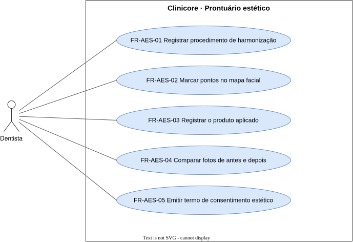

# Prontuário estético — `AES`

O registro dos procedimentos de harmonização orofacial.

## FR-AES-01 — Registro de procedimento de harmonização

> Como dentista, quero registrar um procedimento de harmonização orofacial, para que a estética tenha prontuário próprio.

O sistema deve registrar o procedimento de harmonização orofacial realizado, com o tipo e a data, vinculado ao paciente.

| Atributo | Valor |
| --- | --- |
| Justificativa | Harmonização é forte na odontologia e quase não tem suporte no legado. |
| Origem | Theo, kickoff de 2026-09-15 |
| Prioridade | Must |
| Status | approved |
| Marco | M1 |
| Desde | v1.0.0 |

**Critérios de aceite**

- **FR-AES-01.1** — Dado um procedimento de toxina botulínica registrado, quando o prontuário estético é aberto, então o procedimento aparece com o tipo e a data.

## FR-AES-02 — Mapa facial

> Como dentista, quero marcar no rosto os pontos e as áreas aplicados, para que a próxima aplicação parta do que foi feito.

O sistema deve registrar, sobre um mapa facial, os pontos e as áreas de aplicação de cada procedimento.

| Atributo | Valor |
| --- | --- |
| Justificativa | O mapa registra onde cada aplicação foi feita. |
| Origem | Theo, kickoff de 2026-09-15 |
| Prioridade | Must |
| Status | approved |
| Marco | M1 |
| Desde | v1.0.0 |

**Critérios de aceite**

- **FR-AES-02.1** — Dado um procedimento com pontos marcados, quando é reaberto, então o mapa facial mostra os mesmos pontos.

## FR-AES-03 — Rastreabilidade do produto aplicado

> Como dentista, quero registrar marca, lote, validade e quantidade do produto usado, para que eu identifique o lote num evento adverso.

O sistema deve registrar, em cada procedimento, a marca, o lote, a validade e a quantidade do produto aplicado.

| Atributo | Valor |
| --- | --- |
| Justificativa | Rastrear o produto exige saber o lote aplicado em cada paciente. |
| Origem | Theo, kickoff de 2026-09-15 |
| Prioridade | Must |
| Status | approved |
| Marco | M1 |
| Desde | v1.0.0 |

**Critérios de aceite**

- **FR-AES-03.1** — Dado um procedimento registrado com marca, lote, validade e quantidade do produto, quando é reaberto, então mostra os quatro.

## FR-AES-04 — Fotos de antes e de depois

> Como dentista, quero guardar fotos de antes e de depois de um procedimento, para que o resultado fique registrado.

O sistema deve armazenar fotos de antes e de depois vinculadas a um procedimento.

| Atributo | Valor |
| --- | --- |
| Justificativa | O resultado do procedimento precisa de registro visual. |
| Origem | Theo, kickoff de 2026-09-15 |
| Prioridade | Must |
| Status | approved |
| Marco | M1 |
| Desde | v1.0.0 |

**Critérios de aceite**

- **FR-AES-04.1** — Dado um procedimento, quando o dentista anexa uma foto de antes e uma de depois, então as duas ficam vinculadas a ele.

## FR-AES-05 — Termo de consentimento de estética

> Como dentista, quero emitir o termo específico do procedimento estético, para que o consentimento cubra os riscos daquele procedimento.

O sistema deve emitir termo de consentimento próprio de procedimento de harmonização orofacial.

| Atributo | Valor |
| --- | --- |
| Justificativa | O procedimento estético tem termo de consentimento próprio. |
| Origem | Theo, kickoff de 2026-09-15 |
| Prioridade | Must |
| Status | approved |
| Marco | M1 |
| Desde | v1.0.0 |

**Critérios de aceite**

- **FR-AES-05.1** — Dado um procedimento de harmonização, quando o termo é emitido, então é o termo de estética e fica vinculado ao procedimento.

## FR-AES-06 — Comparação de antes e depois

> Como dentista, quero comparar as fotos de antes e de depois lado a lado, para que o resultado seja demonstrável ao paciente.

O sistema deve apresentar lado a lado as fotos de antes e de depois de um procedimento.

| Atributo | Valor |
| --- | --- |
| Justificativa | A comparação mostra o resultado do procedimento. |
| Origem | Theo, kickoff de 2026-09-15 |
| Prioridade | Must |
| Status | approved |
| Marco | M1 |
| Desde | v2.0.0 |

**Critérios de aceite**

- **FR-AES-06.1** — Dado um procedimento com foto de antes e foto de depois, quando a comparação é aberta, então as duas aparecem lado a lado.

## FR-AES-07 — Busca por lote aplicado

> Como gestor, quero buscar um lote aplicado, para que eu encontre os pacientes num evento adverso.

O sistema deve apresentar, a partir de um lote, os pacientes e os procedimentos em que ele foi aplicado.

| Atributo | Valor |
| --- | --- |
| Justificativa | Num evento adverso, a clínica precisa achar quem recebeu o lote. |
| Origem | Theo, kickoff de 2026-09-15 |
| Prioridade | Must |
| Status | approved |
| Marco | M1 |
| Desde | v2.0.0 |

**Critérios de aceite**

- **FR-AES-07.1** — Dado um lote, quando o gestor o busca, então vê os pacientes e procedimentos em que ele foi aplicado.
