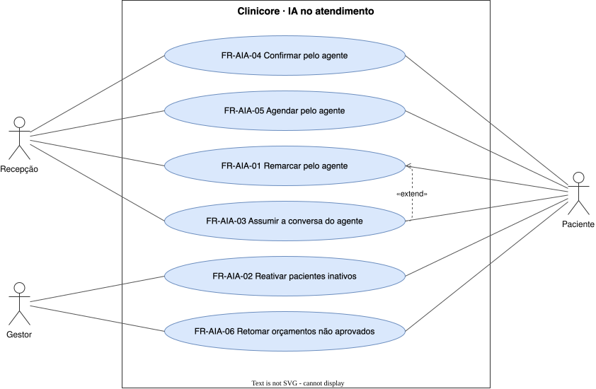

# IA no atendimento — `AIA`

O agente que conversa com o paciente pelo WhatsApp no lugar da recepção.

## FR-AIA-01 — Remarcação pelo agente no WhatsApp

> Como recepção, quero que um agente remarque consultas pelo WhatsApp, para que o paciente seja atendido fora do horário da recepção.

O sistema deve remarcar a consulta a pedido do paciente, por um agente de IA no WhatsApp.

| Atributo | Valor |
| --- | --- |
| Justificativa | O paciente é atendido sem ocupar a recepção. |
| Origem | Theo, kickoff de 2026-09-15 |
| Prioridade | Should |
| Status | approved |
| Marco | M3 |
| Desde | v1.0.0 |

**Critérios de aceite**

- **FR-AIA-01.1** — Dado um paciente que pede remarcação no WhatsApp, quando há horário livre, então o agente remarca e a agenda é atualizada.

## FR-AIA-02 — Reativação de pacientes inativos

> Como gestor, quero que o agente procure os pacientes inativos, para que a clínica recupere receita parada.

O sistema deve enviar pelo WhatsApp, por um agente de IA, mensagem de reativação aos pacientes inativos.

| Atributo | Valor |
| --- | --- |
| Justificativa | Paciente inativo e orçamento parado são receita a recuperar. |
| Origem | Theo, kickoff de 2026-09-15 |
| Prioridade | Should |
| Status | approved |
| Marco | M3 |
| Desde | v1.0.0 |

**Critérios de aceite**

- **FR-AIA-02.1** — Dado um paciente inativo, quando a reativação é disparada, então ele recebe a mensagem e a resposta fica no histórico de comunicação.

## FR-AIA-03 — Passagem para humano

> Como recepção, quero assumir a conversa quando o agente não resolve, para que o paciente não fique sem resposta.

O sistema deve transferir a conversa para a recepção quando o agente não conclui o pedido do paciente.

| Atributo | Valor |
| --- | --- |
| Justificativa | O paciente não pode ficar sem resposta quando o agente não resolve. |
| Origem | Theo, kickoff de 2026-09-15 |
| Prioridade | Should |
| Status | approved |
| Marco | M3 |
| Desde | v1.0.0 |

**Critérios de aceite**

- **FR-AIA-03.1** — Dado um pedido que o agente não conclui, quando isso acontece, então a conversa aparece para a recepção com o histórico.

## FR-AIA-04 — Confirmação pelo agente no WhatsApp

> Como recepção, quero que um agente confirme consultas pelo WhatsApp, para que o paciente seja atendido fora do horário da recepção.

O sistema deve conduzir com o paciente, por um agente de IA no WhatsApp, a confirmação da consulta.

| Atributo | Valor |
| --- | --- |
| Justificativa | O paciente confirma conversando, sem ocupar a recepção. |
| Origem | Theo, kickoff de 2026-09-15 |
| Prioridade | Should |
| Status | approved |
| Marco | M3 |
| Desde | v2.0.0 |

**Critérios de aceite**

- **FR-AIA-04.1** — Dado um paciente que diz ao agente que vem à consulta, quando a conversa termina, então a consulta passa a confirmada na agenda.

## FR-AIA-05 — Agendamento pelo agente no WhatsApp

> Como recepção, quero que um agente marque consultas pelo WhatsApp, para que o paciente seja atendido fora do horário da recepção.

O sistema deve marcar a consulta a pedido do paciente, por um agente de IA no WhatsApp.

| Atributo | Valor |
| --- | --- |
| Justificativa | O paciente marca a consulta sem ocupar a recepção. |
| Origem | Theo, kickoff de 2026-09-15 |
| Prioridade | Should |
| Status | approved |
| Marco | M3 |
| Desde | v2.0.0 |

**Critérios de aceite**

- **FR-AIA-05.1** — Dado um paciente que pede uma consulta no WhatsApp, quando há horário livre, então o agente marca a consulta e ela aparece na agenda.

## FR-AIA-06 — Retomada de orçamentos não aprovados

> Como gestor, quero que o agente procure os pacientes com orçamento não aprovado, para que a clínica recupere a venda parada.

O sistema deve enviar pelo WhatsApp, por um agente de IA, mensagem aos pacientes com orçamento não aprovado.

| Atributo | Valor |
| --- | --- |
| Justificativa | Orçamento parado é receita a recuperar. |
| Origem | Theo, kickoff de 2026-09-15 |
| Prioridade | Should |
| Status | approved |
| Marco | M3 |
| Desde | v2.0.0 |

**Critérios de aceite**

- **FR-AIA-06.1** — Dado um paciente com orçamento não aprovado, quando a retomada é disparada, então ele recebe a mensagem e a resposta fica no histórico de comunicação.
