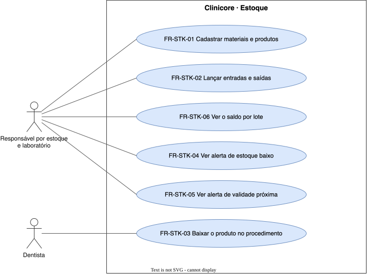

# Estoque — `STK`

Os materiais e produtos da clínica, seu saldo e seus alertas.

## FR-STK-01 — Cadastro de materiais e produtos

> Como responsável por estoque e laboratório, quero cadastrar os materiais e os produtos, inclusive os estéticos, para que o estoque tenha o que controlar.

O sistema deve cadastrar os materiais e os produtos da clínica.

| Atributo | Valor |
| --- | --- |
| Justificativa | Produto estético tem lote e validade que o prontuário precisa referenciar. |
| Origem | Theo, kickoff de 2026-09-15 |
| Prioridade | Must |
| Status | approved |
| Marco | M1 |
| Desde | v1.0.0 |

**Critérios de aceite**

- **FR-STK-01.1** — Dado um produto cadastrado, quando uma entrada é lançada, então o produto pode ser escolhido.

## FR-STK-02 — Entradas e saídas

> Como responsável por estoque e laboratório, quero lançar entradas e saídas com lote e validade, para que cada movimento da prateleira fique registrado.

O sistema deve registrar as entradas e as saídas de cada produto, com lote e validade.

| Atributo | Valor |
| --- | --- |
| Justificativa | O saldo, a rastreabilidade e o alerta de validade partem dos movimentos por lote. |
| Origem | Theo, kickoff de 2026-09-15 |
| Prioridade | Must |
| Status | approved |
| Marco | M1 |
| Desde | v1.0.0 |

**Critérios de aceite**

- **FR-STK-02.1** — Dada uma entrada de 10 unidades de um lote, quando ela é registrada, então o produto mostra o lote com a validade e as 10 unidades.

## FR-STK-03 — Baixa do produto no procedimento

> Como dentista, quero que o produto usado no procedimento estético saia do estoque, para que eu não lance a saída à mão.

O sistema deve baixar do estoque, no registro do procedimento estético, a quantidade do lote aplicado.

| Atributo | Valor |
| --- | --- |
| Justificativa | A baixa automática mantém o saldo do lote igual ao que foi aplicado. |
| Origem | Theo, kickoff de 2026-09-15 |
| Prioridade | Must |
| Status | approved |
| Marco | M1 |
| Desde | v1.0.0 |

**Critérios de aceite**

- **FR-STK-03.1** — Dado um procedimento de toxina botulínica registrado com lote e quantidade, quando é salvo, então o saldo do lote diminui na mesma quantidade.

## FR-STK-04 — Alerta de estoque baixo

> Como responsável por estoque e laboratório, quero ser avisado quando um produto fica abaixo do mínimo, para que eu compre antes de faltar.

O sistema deve sinalizar o produto cujo saldo está abaixo do mínimo configurado para ele.

| Atributo | Valor |
| --- | --- |
| Justificativa | O alerta permite comprar antes de faltar. |
| Origem | Theo, kickoff de 2026-09-15 |
| Prioridade | Must |
| Status | approved |
| Marco | M1 |
| Desde | v1.0.0 |

**Critérios de aceite**

- **FR-STK-04.1** — Dado um produto com saldo abaixo do mínimo, quando o responsável abre o estoque, então vê o alerta desse produto.

## FR-STK-05 — Alerta de validade próxima

> Como responsável por estoque e laboratório, quero ser avisado quando um lote está perto de vencer, para que eu use ou descarte a tempo.

O sistema deve sinalizar o lote cuja validade está dentro da antecedência configurada.

| Atributo | Valor |
| --- | --- |
| Justificativa | O alerta permite usar ou descartar o lote antes de vencer. |
| Origem | Theo, kickoff de 2026-09-15 |
| Prioridade | Must |
| Status | approved |
| Marco | M1 |
| Desde | v1.0.0 |

**Critérios de aceite**

- **FR-STK-05.1** — Dado um lote com validade dentro da antecedência configurada, quando o responsável abre o estoque, então vê o alerta desse lote.

## FR-STK-06 — Saldo por lote

> Como responsável por estoque e laboratório, quero ver o saldo de cada lote, para que o saldo reflita a prateleira.

O sistema deve apresentar o saldo de cada produto por lote.

| Atributo | Valor |
| --- | --- |
| Justificativa | Sem saldo por lote não há rastreabilidade nem alerta de validade. |
| Origem | Theo, kickoff de 2026-09-15 |
| Prioridade | Must |
| Status | approved |
| Marco | M1 |
| Desde | v2.0.0 |

**Critérios de aceite**

- **FR-STK-06.1** — Dada uma entrada de 10 unidades de um lote e uma saída de 3, quando o saldo é consultado, então o lote mostra 7.
