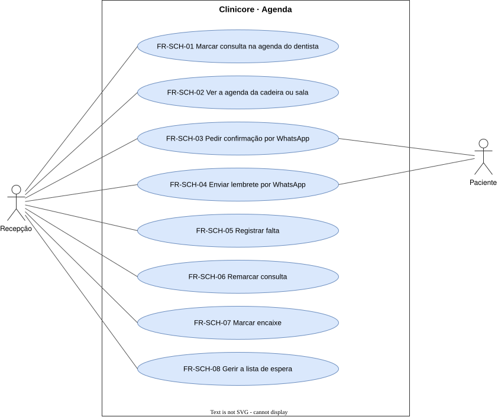

# Agenda — `SCH`

A marcação de consultas, a comunicação com o paciente e o que acontece quando o horário não é cumprido.

## FR-SCH-01 — Agenda por dentista

> Como recepção, quero marcar e consultar os horários de cada dentista, para que eu saiba quem atende quem e quando.

O sistema deve registrar cada consulta na agenda do dentista que a atende.

| Atributo | Valor |
| --- | --- |
| Justificativa | A agenda é a operação diária da clínica. |
| Origem | Theo, kickoff de 2026-09-15 |
| Prioridade | Must |
| Status | approved |
| Marco | M1 |
| Desde | v1.0.0 |

**Critérios de aceite**

- **FR-SCH-01.1** — Dada uma consulta marcada para um dentista, quando a agenda dele é aberta no dia, então a consulta aparece no horário marcado.
- **FR-SCH-01.2** — Dado um horário já ocupado de um dentista, quando outra consulta que não é encaixe é marcada nele, então o sistema recusa.

## FR-SCH-02 — Agenda por cadeira ou sala

> Como recepção, quero ver a ocupação de cada cadeira ou sala, para que duas consultas não disputem o mesmo espaço.

O sistema deve registrar cada consulta na agenda da cadeira ou da sala que ela ocupa.

| Atributo | Valor |
| --- | --- |
| Justificativa | Duas consultas não ocupam a mesma cadeira ao mesmo tempo. |
| Origem | Theo, kickoff de 2026-09-15 |
| Prioridade | Must |
| Status | approved |
| Marco | M1 |
| Desde | v1.0.0 |

**Critérios de aceite**

- **FR-SCH-02.1** — Dada uma cadeira ocupada num horário, quando outra consulta que não é encaixe é marcada nela no mesmo horário, então o sistema recusa.

## FR-SCH-03 — Pedido de confirmação por WhatsApp

> Como recepção, quero que o paciente receba pelo WhatsApp o pedido de confirmação da consulta, para que eu não ligue para cada paciente.

O sistema deve enviar ao paciente, por WhatsApp e com a antecedência configurada pela clínica, um pedido de confirmação da consulta.

| Atributo | Valor |
| --- | --- |
| Justificativa | A confirmação automática tira da recepção o contato um a um. |
| Origem | Theo, kickoff de 2026-09-15 |
| Prioridade | Must |
| Status | approved |
| Marco | M1 |
| Desde | v1.0.0 |

**Critérios de aceite**

- **FR-SCH-03.1** — Dada uma consulta marcada, quando chega a antecedência de confirmação configurada pela clínica, então o paciente recebe o pedido no WhatsApp.

## FR-SCH-04 — Lembrete por WhatsApp

> Como recepção, quero que o paciente seja lembrado da consulta, para que ele não falte por esquecimento.

O sistema deve enviar ao paciente, por WhatsApp e com a antecedência configurada pela clínica, um lembrete da consulta.

| Atributo | Valor |
| --- | --- |
| Justificativa | O lembrete evita a falta por esquecimento. |
| Origem | Theo, kickoff de 2026-09-15 |
| Prioridade | Must |
| Status | approved |
| Marco | M1 |
| Desde | v1.0.0 |

**Critérios de aceite**

- **FR-SCH-04.1** — Dada uma consulta confirmada, quando chega a antecedência de lembrete configurada pela clínica, então o paciente recebe o lembrete no WhatsApp.

## FR-SCH-05 — Registro de falta

> Como recepção, quero registrar que o paciente não compareceu, para que a falta entre no histórico e no indicador.

O sistema deve permitir registrar a falta do paciente numa consulta.

| Atributo | Valor |
| --- | --- |
| Justificativa | Sem a falta registrada não existe taxa de faltas. |
| Origem | Theo, kickoff de 2026-09-15 |
| Prioridade | Must |
| Status | approved |
| Marco | M1 |
| Desde | v1.0.0 |

**Critérios de aceite**

- **FR-SCH-05.1** — Dada uma consulta cujo paciente não veio, quando a recepção registra a falta, então ela aparece no histórico do paciente.

## FR-SCH-06 — Remarcação

> Como recepção, quero mover uma consulta para outro horário, para que o vínculo com o paciente e o tratamento se mantenha.

O sistema deve permitir remarcar uma consulta para outro horário, mantendo o registro do horário original.

| Atributo | Valor |
| --- | --- |
| Justificativa | Apagar e recriar a consulta perde o registro do horário original. |
| Origem | Theo, kickoff de 2026-09-15 |
| Prioridade | Must |
| Status | approved |
| Marco | M1 |
| Desde | v1.0.0 |

**Critérios de aceite**

- **FR-SCH-06.1** — Dada uma consulta remarcada, quando o histórico do paciente é aberto, então mostra o horário original e o novo.

## FR-SCH-07 — Encaixe

> Como recepção, quero encaixar um paciente fora dos horários livres, para que uma urgência seja atendida no mesmo dia.

O sistema deve permitir marcar uma consulta de encaixe num horário já ocupado, identificada como encaixe.

| Atributo | Valor |
| --- | --- |
| Justificativa | Uma urgência precisa de atendimento fora dos horários livres. |
| Origem | Theo, kickoff de 2026-09-15 |
| Prioridade | Must |
| Status | approved |
| Marco | M1 |
| Desde | v1.0.0 |

**Critérios de aceite**

- **FR-SCH-07.1** — Dado um horário ocupado, quando a recepção marca um encaixe nele, então a consulta é criada e aparece identificada como encaixe.

## FR-SCH-08 — Inclusão na lista de espera

> Como recepção, quero incluir na lista de espera o paciente que quer um horário mais cedo, para que eu o chame numa desistência.

O sistema deve registrar na lista de espera o paciente que quer um horário mais cedo que o marcado.

| Atributo | Valor |
| --- | --- |
| Justificativa | Um horário liberado pode ser oferecido a quem espera. |
| Origem | Theo, kickoff de 2026-09-15 |
| Prioridade | Must |
| Status | approved |
| Marco | M1 |
| Desde | v1.0.0 |

**Critérios de aceite**

- **FR-SCH-08.1** — Dado um paciente com consulta marcada, quando a recepção o inclui na lista de espera, então ele aparece na lista com a consulta que tem.

## FR-SCH-09 — Resposta da confirmação na agenda

> Como recepção, quero ver na agenda a resposta do paciente ao pedido de confirmação, para que eu saiba quem vem sem ligar.

O sistema deve registrar na consulta a resposta do paciente ao pedido de confirmação.

| Atributo | Valor |
| --- | --- |
| Justificativa | A resposta do paciente atualiza a agenda sem passar pela recepção. |
| Origem | Theo, kickoff de 2026-09-15 |
| Prioridade | Must |
| Status | approved |
| Marco | M1 |
| Desde | v2.0.0 |

**Critérios de aceite**

- **FR-SCH-09.1** — Dada a resposta do paciente ao pedido de confirmação, quando ela chega, então a consulta passa a confirmada ou a cancelada na agenda.

## FR-SCH-10 — Lista de espera no horário liberado

> Como recepção, quero ver a lista de espera quando um horário é liberado, para que eu preencha a desistência.

O sistema deve apresentar a lista de espera ao lado do horário liberado por um cancelamento.

| Atributo | Valor |
| --- | --- |
| Justificativa | Um horário liberado pode ser oferecido a quem espera. |
| Origem | Theo, kickoff de 2026-09-15 |
| Prioridade | Must |
| Status | approved |
| Marco | M1 |
| Desde | v2.0.0 |

**Critérios de aceite**

- **FR-SCH-10.1** — Dado um paciente na lista de espera, quando uma consulta é cancelada, então a recepção vê a lista ao lado do horário liberado.
