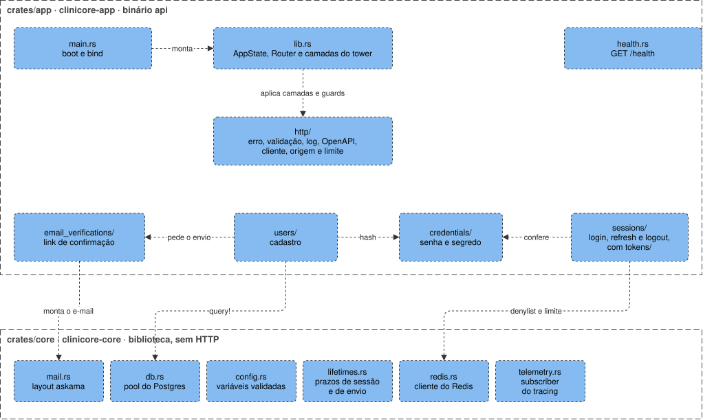

# `apps/api`

A API HTTP que o web e o app consomem, em Rust com axum e sqlx. Fala com o PostgreSQL e com o Redis, e é
onde mora toda a regra de negócio. Não fala com o SMTP: o e-mail vai para a fila `email_outbox`, e o
[worker](worker.md) o envia.

**Nunca faz:** servir tela, guardar estado em memória entre requisições, montar SQL por concatenação.

## Blocos internos

| Bloco | Onde | Responsabilidade |
| --- | --- | --- |
| Boot | `crates/app/src/main.rs` | lê a configuração, liga o `tracing` e faz o bind |
| Router | `crates/app/src/lib.rs` | o `AppState`, as rotas e as camadas do tower: log, CORS, panic, IP do cliente e limite de corpo |
| Encanamento HTTP | `crates/app/src/http/` | erro em Problem Details, extractor de validação, log de requisição, OpenAPI, o header `Clinicore-Client`, a guarda de origem, o IP do cliente pela `CLIENT_IP_SOURCE`, o limite de requisições e o `Cache-Control: no-store` |
| `health` | `crates/app/src/health.rs` | `GET /health` |
| `users` | `crates/app/src/users/` | o cadastro, em `POST /users` |
| `email_verifications` | `crates/app/src/email_verifications/` | o pedido e a confirmação do link de e-mail |
| `email_outbox` | `crates/app/src/email_outbox.rs` | reserva o envio pelo limite de cada endereço e grava o e-mail na fila, na transação de quem pede o envio |
| `sessions` | `crates/app/src/sessions/` | login, leitura da sessão, refresh e logout, com os tokens em `tokens/` |
| `oauth` | `crates/app/src/oauth/` | o login com Google por OpenID Connect com PKCE, com o `id_token` conferido, e o vínculo com a conta do mesmo e-mail |
| `credentials` | `crates/app/src/credentials/` | o endereço de e-mail normalizado, a política e o hash Argon2 da senha, e o segredo aleatório com o hash dele, usados por várias features |
| `core` | `crates/core/` | configuração, pool do Postgres, cliente do Redis, o template do e-mail, o sinal de parada, o subscriber do `tracing` e os prazos que a API divide com o [worker](worker.md); biblioteca que não conhece HTTP |

As features de produto — pacientes, agenda, prontuário, financeiro, estoque, laboratório — entram como
pastas novas em `crates/app/src/`, no M1.

## Rotas da autenticação

O contrato da [spec 007](../../../work/specs/autenticacao/007-cadastro-confirmacao-e-sessao-api.md). As
rotas do Google, da recuperação e da troca de senha entram com a spec da #7.

| Método e caminho | O que faz |
| --- | --- |
| `GET /health` | responde que o processo está de pé |
| `POST /users` | cria a conta com e-mail e senha |
| `POST /email-verifications` | pede um novo link de confirmação |
| `POST /email-verifications/confirmation` | confirma o e-mail com o token do link |
| `POST /sessions` | entra com e-mail e senha |
| `GET /sessions/current` | lê o usuário da sessão |
| `DELETE /sessions/current` | sai e revoga a sessão |
| `POST /sessions/current/tokens` | rotaciona o refresh token |

Fora de produção, o documento OpenAPI fica em `/api-json` e a interface dele em `/api`.

## Para mudar com segurança

As camadas, a ordem dos guards, as regras de SQL, de erro e de teste estão no
[`apps/api/AGENTS.md`](https://github.com/TheoOdawara/clinicore/blob/staging/apps/api/AGENTS.md). O que o cliente observa — URL, status, cookies,
limites e o formato do erro — é contrato, e toda rota nova chega a cada cliente escrita à mão
([web.md](web.md), [android.md](android.md), [ios.md](ios.md)).
