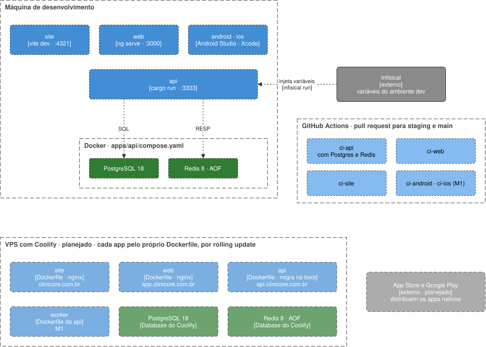

# Implantação

Onde cada bloco roda, em cada ambiente, e como ele chega lá.

## Ambientes

| Ambiente | Estado | Onde roda |
| --- | --- | --- |
| Desenvolvimento | existe | a máquina de quem desenvolve |
| CI | existe para a API, o web e o Android, pelo `ci-api.yml`, pelo `ci-web.yml`, pelo `ci-android.yml` e pelo `ci-security.yml`; cada outro app ganha o seu workflow no scaffold dele | GitHub Actions |
| Homolog (`staging`) | planejado | a VPS com Coolify |
| Produção (`main`) | planejado | a VPS com Coolify |

**Não há hospedagem.** A VPS só entra quando o desenvolvimento terminar; até lá, cada entrega é conferida
rodando local. Nenhum app tem Dockerfile ainda. Cada um vai ser publicado no Coolify pelo
próprio `apps/<app>/Dockerfile`, por rolling update, como decide a
[ADR 0014](../../decisions/0014-deploy-por-dockerfile-no-coolify.md).

## Desenvolvimento

| Bloco | Como roda | Porta |
| --- | --- | --- |
| `apps/api` | `cargo run`, dentro do `infisical run --path=/api --` | 3333 |
| `apps/web` | `bun run dev` | 3000 |
| `apps/site` | `bun run dev` | 4321 |
| `apps/android` | Android Studio, no emulador ou no aparelho (M1) | — |
| `apps/ios` | Xcode, no simulador ou no aparelho (M1) | — |
| PostgreSQL 18 e Redis 8 | `docker compose up -d --wait`, dentro do `infisical run --path=/api --`, pelo `apps/api/compose.yaml` (projeto `clinicore`) | `POSTGRES_PORT` e `REDIS_PORT` do Infisical |

As variáveis da API vêm do Infisical, no ambiente `dev`, e o `apps/api/.env` local, fora do git, é mantido
sempre igual a ele. No emulador Android, a API local é `http://10.0.2.2:3333`.

## Produção e homolog — planejado

| Bloco | Endereço | Como roda |
| --- | --- | --- |
| `apps/site` | `clinicore.com.br` | aplicação do Coolify pelo `apps/site/Dockerfile`, com o nginx servindo o build estático do SvelteKit |
| `apps/web` | `app.clinicore.com.br` | aplicação do Coolify pelo `apps/web/Dockerfile`, com o nginx servindo o build do Angular |
| `apps/api` | `api.clinicore.com.br` | aplicação do Coolify pelo `apps/api/Dockerfile`, com o binário `api`, que migra o schema no boot |
| worker | — | aplicação do Coolify com o Dockerfile da API e o binário `worker` |
| PostgreSQL 18 | rede interna | recurso Database do Coolify, com volume cifrado ([NFR-SEC-05](../../product/requirements/non-functional/security.md#nfr-sec-05--criptografia-em-repouso)) |
| Redis 8 | rede interna | recurso Database do Coolify, com `--appendonly yes` e volume |
| `apps/android` e `apps/ios` | Google Play e App Store | publicados pelas lojas |

Os três domínios compartilham o domínio registrável, o que mantém o cookie de sessão em
`SameSite=Lax`. Atrás do proxy, a API lê o IP do cliente do header que só o proxy escreve, definido em
`CLIENT_IP_SOURCE`, e só pode ser alcançável por ele. Nenhuma aplicação publica porta no host.

Backup e recuperação estão em aberto, na
[OQ-11](../../product/requirements/open-questions.md#oq-11--backup-e-recuperação).

## Entrega

- **Toda entrega chega por pull request** para a `staging`; o release é um pull request da `staging`
  para a `main`.
- **O CI roda só onde houve mudança** ([ADR 0024](../../decisions/0024-ci-por-mudanca-em-repositorio-publico.md)):
  um workflow por app (`ci-api.yml`, com PostgreSQL e Redis de serviço, `ci-web.yml`, `ci-android.yml` e `ci-site.yml`),
  disparado pelo caminho do app, e o `ci-security.yml` com o gitleaks em todo pull request. O push na
  `staging` roda o app inteiro. Os gates são os da skill `gates`.
- **Não há deploy automático.** Ele nasce junto da hospedagem.
- **Toda publicação é um rolling update.** O container novo sobe ao lado do antigo e só recebe tráfego
  depois de passar no health check do `/health`; o antigo para em seguida. Por isso toda migration é
  compatível com a versão anterior da API
  ([NFR-REL-04](../../product/requirements/non-functional/reliability.md#nfr-rel-04--publicação-sem-indisponibilidade)).
- **O workflow do iOS nasce com o scaffold dele.** O `ci-android.yml` roda sem emulador; a acessibilidade
  e o Maestro rodam no emulador local, até a ADR 0024 ligar o emulador no CI.
